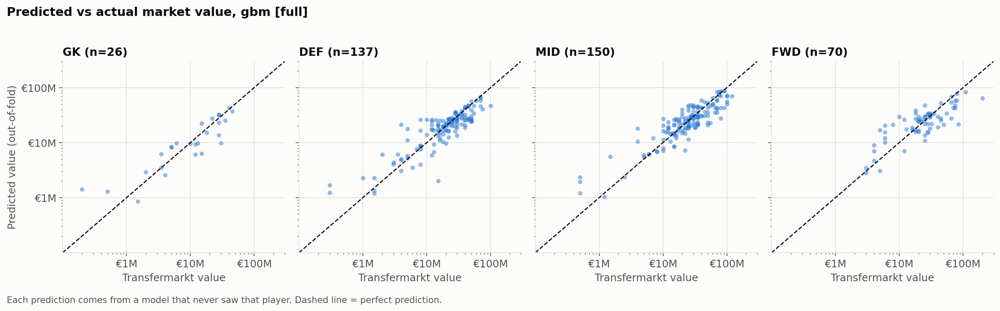
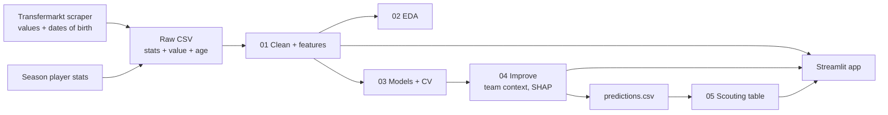
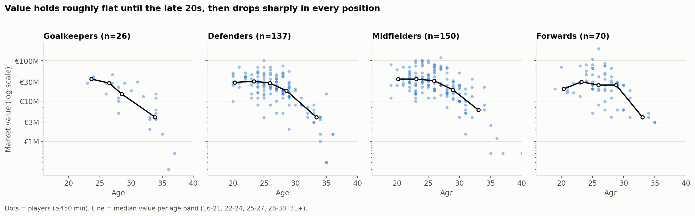
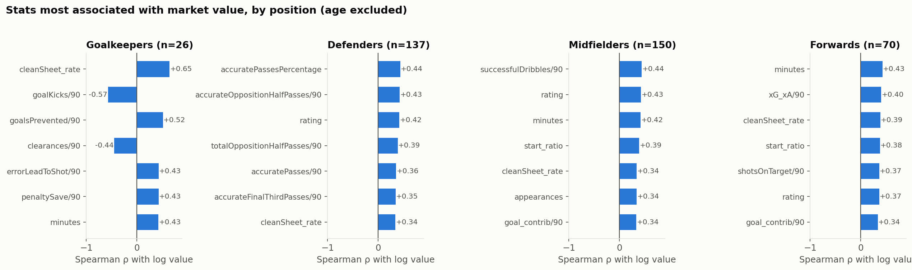
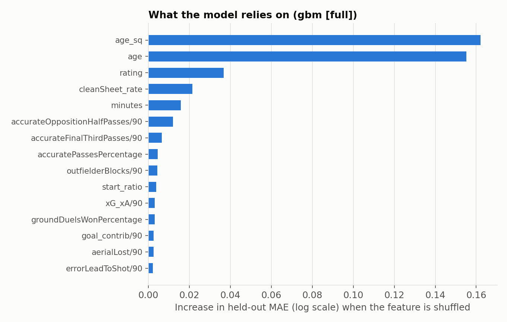
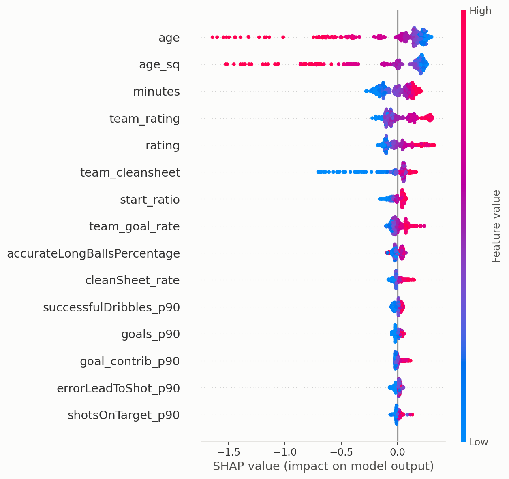
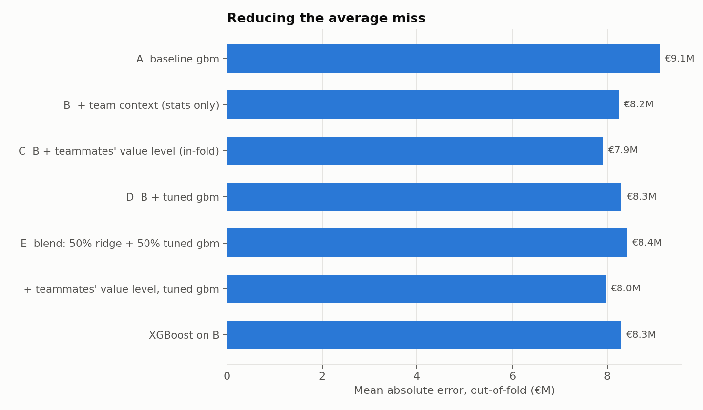
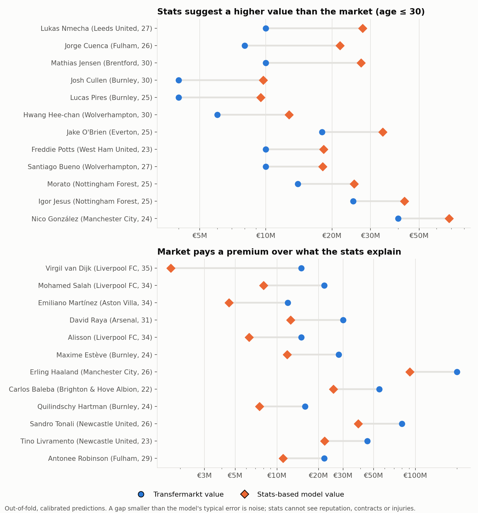

# Premier League Market Value Predictor (2025/26)

Can a player's season statistics, age and position explain his **Transfermarkt market value**? And where does the
market disagree with the numbers?

This project goes from raw data to an interactive app: scraping, cleaning, feature engineering, cross-validated
modelling, error analysis, a scouting table of players valued differently from what their stats suggest, and a
Streamlit app to explore everything.

Built as a personal project to combine my passion for football with my data science studies.

**🔗 Live app:** [Visit the app](https://premier-league-market-value-prediction-676edgimbjekppgyov5n8j.streamlit.app/)

![App preview]


---

## Contents

1. [Headline results](#headline-results)
2. [Pipeline overview](#pipeline-overview)
3. [Step by step](#step-by-step)
   - [1. Data collection and scraping](#1-data-collection-and-scraping)
   - [2. Cleaning](#2-cleaning)
   - [3. Feature engineering](#3-feature-engineering)
   - [4. Exploratory analysis](#4-exploratory-analysis)
   - [5. Modelling and evaluation](#5-modelling-and-evaluation)
   - [6. Improving the model](#6-improving-the-model)
   - [7. Per-player predictions](#7-per-player-predictions)
   - [8. Scouting table](#8-scouting-table)
   - [9. Streamlit app](#9-streamlit-app)
4. [Outputs](#outputs)
5. [Project structure](#project-structure)
6. [How to run](#how-to-run)
7. [Limitations](#limitations)
8. [Next steps](#next-steps)
9. [Data note](#data-note)

---

## Headline results

Repeated stratified 5-fold cross-validation (3 repeats) on **383 players** with at least 450 minutes played.
The target is `log(market value)`; errors are reported back in euros. Every prediction comes from a model that never
saw that player.

| Model | R² (log value) | Average miss | Median error |
|---|---|---|---|
| Position median only | 0.02 | €16.4M | 48% |
| Age + position + minutes only (Ridge) | 0.67 | €12.3M | 37% |
| Ridge, all features | 0.70 | €10.1M | 32% |
| Random forest, all features | 0.71 | €10.1M | 29% |
| Gradient boosting, all features | 0.76 | €9.1M | 28% |
| **Gradient boosting + team context** | **0.81** | **€8.2M** | **26%** |



**The short version**

- **Age explains most of the value.** Age, position and minutes alone reach R² = 0.67.
- **Team context was the lever that worked.** Teammates' average rating, goal rate and clean-sheet rate cut the
  average miss by about €0.9M.
- **Tuning, blending and XGBoost did not help.** On this small dataset the information in the features is the
  bottleneck, not the algorithm.
- **The market values more than stats:** stars, reputation and club context are what the model cannot see.

---

## Pipeline overview



`run_all.py` runs steps 1 to 5 in order and writes everything to `outputs/`.

---

## Step by step

### 1. Data collection and scraping

Script: `src/scrape_transfermarkt_pl.py` (optional, not part of `run_all.py`)

- Scrapes the 2025/26 Premier League squads from Transfermarkt: club list, then one page per squad.
- Collects for each player: Transfermarkt `player_id`, name, club, position, **market value (EUR)** and
  **date of birth**, from which age at season end (31 May 2026) is computed.
- Polite by design: browser-like User-Agent (without it Transfermarkt answers 403), a 4-second delay between requests,
  and the result is cached in a CSV rather than re-scraped.
- Values like `€45.00m` or `€900k` are parsed into integers.

The season statistics (appearances, minutes, goals, passes, duels, saves, ratings, xG, ...) come from a player-level
season stats table [premier_league_complete_stats_until35thGameDayOnSeason2025-26](https://kaggle.com)
The final input, `data/PL_players_stats_ready.csv`, holds **507 players x 109 columns**: stats + market value + age,
and is already merged, so the scraper does not need to be re-run to reproduce the results.

### 2. Cleaning

Script: `src/01_clean_and_features.py` (part 1)

- **Audit first:** shape, duplicates (none), players per position, value distribution, missing values. Market
  value is right-skewed (skew 2.10 raw, -1.12 after log), so the model predicts `log(value)`.
- **Encoding repairs:** names had double-encoded accents (`Andrés` -> `Andrés`) and HTML entities
  (`Brighton & Hove Albion`); both are fixed.
- **Missing values:** `expectedGoals` and `expectedAssists` missing means no shots or chances were tracked, and
  `goalsPrevented` only exists for goalkeepers, so all three are filled with 0.
- **Minutes filter:** players under **450 minutes** are removed (per-90 stats are mostly noise on tiny samples):
  507 -> **383 players** (150 MID, 137 DEF, 70 FWD, 26 GK).
- **Redundant or leaky columns dropped:** `goalsAssistsSum`, `inaccuratePasses`, `scoringFrequency`,
  left/right-foot goals, duplicates of tackles, and `totwAppearances` (team-of-the-week count, which leaks the
  rating signal).

The audit is saved to `outputs/pl_audit.txt`.

### 3. Feature engineering

Script: `src/01_clean_and_features.py` (part 2). Output: `outputs/pl_features.csv` (383 players, about 121 features).

| Group | What it is |
|---|---|
| Per-90 stats | All 76 counting stats divided by minutes x 90 |
| Rates | 11 percentage columns kept as they are (pass accuracy, duels won, ...) |
| Clean-sheet rate | Clean sheets per appearance (a team result, so not per 90) |
| Context | Age, `age²` (captures the age peak), minutes, appearances, start ratio, match rating |
| Composites | Goal contributions, xG + xA, defensive actions, chance creation, xG over-performance |
| Position | One-hot `GK / DEF / MID / FWD` |
| Interactions | 18 position x stat features, e.g. `FWD x goals_p90`, `GK x cleanSheet_rate` |

The interactions encode the football hypothesis directly: *clean sheets matter for keepers, goals for strikers,
recoveries for midfielders*. Step 5 tests whether that is true.

### 4. Exploratory analysis

Script: `src/02_eda.py`



- Value falls steadily with age after the mid-20s, in every position.
- Spearman correlations with value, by position, show different drivers: for goalkeepers the clean-sheet rate
  (+0.65); for defenders pass accuracy (+0.44); for midfielders successful dribbles (+0.44); for forwards minutes
  and xG + xA.



### 5. Modelling and evaluation

Script: `src/03_model.py`

- **Validation:** repeated stratified 5-fold CV (3 repeats), stratified by position. Metrics: MAE, RMSE, R² on the
  log scale, plus MAE and median % error in euros.
- **Models:** Ridge, random forest, gradient boosting, compared with two naive baselines (position median;
  age + position + minutes only).
- **Ablations:** without `rating`, without position interactions, and one model per position.
- **Importance:** permutation importance computed on held-out folds.

What the experiments showed:

1. **Age explains most of the value.** Age + position + minutes reach R² = 0.67; performance stats add about 0.09.
2. **The position-specific hypothesis is only partly supported.** Clean-sheet rate is a real signal for goalkeepers
   and the 4th most important feature overall, but ball recoveries are *not* a top driver for defenders and
   midfielders; passing accuracy and dribbling rank higher.
3. **Hand-built interactions did not help** the tree models, and **one model per position was clearly worse**
   (goalkeepers: €4.7M -> €8.3M average miss) because there are too few players per position.
4. **The `rating` column is not hiding everything else:** removing it moves the error from €9.1M to €9.3M.
5. **The misses are informative.** Haaland (€200M listed) is under-predicted, so are very old players, and five of
   the ten biggest over-predictions are Burnley players: Transfermarkt values players on club context and
   reputation, which stats do not capture.



### 6. Improving the model

Script: `src/04_improve.py`

The biggest misses were systematic, so I tested fixes with the same cross-validation:

| Version | R² (log) | Average miss | Median error |
|---|---|---|---|
| Baseline gradient boosting | 0.755 | €9.1M | 28% |
| + team context (teammates' average rating, goal rate, clean-sheet rate; stats only) | 0.811 | €8.2M | 26% |
| + teammates' average market value (computed inside each CV fold) | 0.812 | €7.9M | 25% |
| Hyper-parameter tuning on top of team context | 0.811 | €8.3M | 26% |
| 50/50 blend of Ridge and gradient boosting | 0.807 | €8.4M | 27% |
| XGBoost on team context | 0.813 | €8.3M | 27% |

- **Team context is the lever that worked.** It is computed leave-one-out (a player is never part of his own team
  average) and minutes-weighted. It nearly removed the Burnley bias (mean log error on the 21 Burnley players
  +0.73 -> +0.15).
- **Tuning and blending did not help.** The default settings were already near the best this small dataset allows.
- **The teammate-value feature is a diagnostic, not the main model:** it needs other players' market values at
  prediction time.
- **Still unsolved:** stars are under-predicted (mean log error -0.30 for the 45 players valued at €60M or more).

#### What the model uses (SHAP)



Age dominates (older players are pushed down by up to about -1.6 on the log scale), and the three team-context
features are among the top eight. Individual attacking or defensive stats have comparatively small effects.
SHAP shows what the model relies on, not what causes value: team features may partly stand for club prestige.



### 7. Per-player predictions

`outputs/predictions.csv` has one row per player (383), sorted by real value:

`player_name, team_name, position, age, minutes, market_value_eur, pred_baseline_eur, pred_team_context_eur,
error_eur, error_pct`

- Predictions are **out-of-fold**: each player is predicted by models that never saw him, averaged over the 3 CV
  repeats.
- `error_pct` is negative when the model **under**-predicts (Haaland: -60% with the baseline model).
- The average miss from this file (€8.1M) is slightly lower than the €8.2M headline figure, which scores each repeat
  separately.

### 8. Scouting table

Script: `src/05_scouting.py`. Output: `outputs/scouting_table.csv`, `outputs/scouting_undervalued_overvalued.png`

Comparing the model's value with Transfermarkt's gives a list of players whose market value is **lower** than their
stats suggest, and players the market values at a **premium**.



A raw sort by gap is misleading: the model pulls predictions toward the average, so the top of a raw list was full
of 35-40 year-olds worth €300k. Three corrections:

1. **Calibration:** fit `log(actual) = a + b x log(predicted)` so the gap is not biased by value level.
2. **Filters:** at least 900 minutes, a market value of at least €3M, and age 30 or under for the
   "higher value" list.
3. **Threshold:** a gap only counts as strong above 0.5 on the log scale, about 1.5x the model's typical error.
   Of 310 eligible players, **19** are "stats suggest higher value", **36** are "market pays a premium" and **255**
   are within model error.

`scouting_table.csv` lists every player with `model_value_eur`, the gap, a verdict, and `gap_vs_club_log` (the gap
relative to the player's own club, which separates a player-level signal from a club-level one).

How to read it:

- **"Stats suggest higher value"** means *worth a look*, not *bargain*. Typical examples are players at weaker clubs
  whose numbers are good but whose value is low (several Burnley players appear).
- **"Market pays a premium"** is mostly reputation: stars, goalkeepers in their 30s at big clubs (van Dijk, Salah,
  Alisson, Raya) and young players valued on potential.
- **This has not been validated.** There are no future values in the data, so I cannot show that flagged players
  later gained value. The honest test is to re-scrape values after the next transfer window and check whether the
  "higher value" group moved up more than the rest.

### 9. Streamlit app

File: `app.py`. An EA FC-inspired dark theme

| Page | What you can do |
|---|---|
| **Overview** | Headline metrics, model comparison, key takeaways |
| **Predict a value** | Start from a real player or a typical player at a position, edit age, minutes, rating, key stats and club, and see the estimate with an 80% range and a value-by-age curve |
| **Model vs market** | Interactive scatter of real vs predicted values, player highlighter, biggest over- and under-predictions |
| **Scouting table** | Filter by position, team, minutes, value and age, adjust the gap threshold, download the result as CSV |
| **Insights** | Permutation importance, SHAP, age and position charts, bias by group, limitations |


How the **Predict a value** page works:

- The team-context gradient boosting model is re-fitted at start-up (5 seeds averaged, cached) on
  `outputs/pl_features.csv`.
- For a real player the estimate is anchored on his out-of-fold prediction and moved by the model's change between
  his original and edited profile, so an unedited player matches `predictions.csv` exactly.
- Moving a player to another club changes the team-context features (teammates' rating, goal rate and clean-sheet
  rate), which is why a player's value drops when he "joins" a weaker team.
- The 80% range is the 10th to 90th percentile of real/predicted ratios in the out-of-fold predictions.

---

## Outputs

| File | Content |
|---|---|
| `outputs/pl_audit.txt` | Data audit: shape, missing values, cleaning decisions |
| `outputs/pl_features.csv` | Modelling table: identifiers, target and ~121 engineered features |
| `outputs/eda_*.png` | Age vs value, value by position, per-position correlations |
| `outputs/model_results.csv` | Cross-validated results for every model and ablation |
| `outputs/model_per_position.csv` | Pooled vs per-position models, by position |
| `outputs/model_feature_importance.csv/.png` | Permutation importance |
| `outputs/model_misses.csv` | Biggest over- and under-predictions of the baseline model |
| `outputs/model_comparison.png`, `model_pred_vs_actual.png` | Model comparison and predicted vs actual |
| `outputs/improve_results.csv/.png` | Team context, tuning, blending, XGBoost |
| `outputs/improve_group_bias.csv` | Mean signed error by group (Burnley, stars, older players) |
| `outputs/shap_summary.png` | SHAP summary of the team-context model |
| `outputs/predictions.csv` | Out-of-fold prediction for every player |
| `outputs/scouting_table.csv` | Calibrated gap and verdict for every player |
| `outputs/scouting_undervalued_overvalued.png` | Dumbbell chart of the largest gaps |

---

## Project structure

```
data/PL_players_stats_ready.csv   player stats + Transfermarkt market value + age (input)
src/scrape_transfermarkt_pl.py    optional: scraper for market values and dates of birth
src/01_clean_and_features.py      audit, cleaning, per-90 features, position interactions
src/02_eda.py                     exploratory plots
src/03_model.py                   cross-validated models, evaluation, importance, biggest misses
src/04_improve.py                 team-context features, tuning, blending, XGBoost, SHAP
src/05_scouting.py                calibrated gap between model value and market value
run_all.py                        runs steps 1 to 5
app.py                            Streamlit app (reads outputs/)
.streamlit/config.toml            app theme
outputs/                          generated tables and figures
assets/                           screenshots used in this README
```

---

## How to run

```bash
pip install -r requirements.txt

python run_all.py          # about 10 minutes; everything lands in outputs/
streamlit run app.py       # the app (the outputs/ folder is already included in the repo)
```

- Python 3.10+ recommended.
- `xgboost` and `shap` are optional: without them the XGBoost row and the SHAP plot are skipped.
- The scraper is **not** part of `run_all.py` because the input CSV already contains the scraped values. Run
  `python src/scrape_transfermarkt_pl.py` yourself to refresh them, and keep the request delay.

---

## Limitations

- **One season, 383 players.** No time-based split is possible, so results come from cross-validation and the error
  estimates are noisy, especially for the 26 goalkeepers.
- **Values are a snapshot.** They are the Transfermarkt values at scraping time, not necessarily end-of-season values.
  If they were collected after the summer window, they include information that postdates the stats.
- **Stats can't see everything:** contract length, injuries, club prestige, nationality and hype all move market
  values and are absent here.
- **Tails are compressed:** the model under-predicts the very top (stars) and over-predicts the very bottom, and is
  biased on very old players.
- **Team features may stand for club prestige** rather than team quality, so SHAP importance is not causal.
- **The scouting table is not validated:** there are no future values to test whether flagged players later gained
  value.
- **The prediction range is approximate:** it uses pooled out-of-fold errors, so it is wider than needed for typical
  players and too narrow for stars.

---

## Data note

Market values come from **Transfermarkt**, and the original player statistics are sourced from the Kaggle dataset **premier_league_complete_stats_until35thGameDayOnSeason2025-26**. 
All data is used here for personal, educational purposes only. Please respect the terms of the original data sources if you reuse or redistribute the data.

